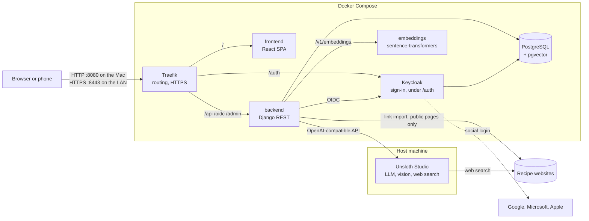

# PlateMates

**The weekly menu and the shopping list for people who eat together**: a family, a person living
alone, flatmates, a group of friends, a sports team, an office canteen. An LLM-driven assistant
builds the team's recipe book and proposes varied, seasonal weekly menus; the shopping list
follows from the menu.

Everything runs on your own hardware (a Mac, a Raspberry Pi, a small VM) with a local LLM, and
every AI component can be swapped for another one, local or cloud, without touching the
application.

## What it does today

| Area | Status |
| --- | --- |
| **Recipe book**: structured recipes, ingredients scaled to the number of people, two-level seasonality, cuisine, tools, ratings | Built |
| **Community**: system recipes (PlateMates), recipes teams choose to share (signed or anonymous), added to the team's book as they are, and changed into the team's own version at the first edit (shown beside the original, differences marked); recipe book, community or both in one screen, one card per dish | Built |
| **System recipes from the web**: LLM drafts grounded on verified recipe pages, with reliability and web rating, reviewed and published by staff | Built |
| **Menu generation from community recipes**: real recipes instead of invented dishes, so every constraint and the shopping list hold | Next |
| **Recipe assistant**: add a recipe by telling it in your own words, by pasting a link, by taking a photo of a cookbook page or a handwritten card, or by asking it to search your recipes, other teams' recipes and the web; every draft is reviewed before saving | Built |
| **Teams**: sign-in with email/password or Google, Microsoft, Apple (Keycloak); invitation-only access; interface in Italian and English, remembered per user | Built |
| **Team management**: profile (weekday time limit, kitchen tools), people at the table with ages, users and roles, invitation links to copy or share | Built |
| **Team calendar and menu screen**: a typical week (which days, how many at breakfast, lunch and dinner), exceptions on specific dates (guests, someone away), each meal's people and dishes, picked by hand from the recipe book for now | Built |
| **Shared catalogs**: ~160 common ingredients with Italian seasonality, kitchen tools; management section to edit, merge duplicates, add new ones | Built |
| **Operations**: one-command Docker Compose stack, HTTPS on the home network for phones, backups and restore, repeatable setup; application settings changed live by administrators (Keycloak role), with a Redis cache they can inspect and clear | Built |
| **Menu planning rules**: rules in plain language at three levels (system, team, this week), each team rule switchable per week; the menu screen's button to plan the week | Built |
| **Weekly menu generation**: in the background with the local LLM, following the rules; starts from a partly planned week, keeps the dishes already set, proposes new dishes beside the recipe book and changes to the people; everything is reviewed meal by meal before it counts | Built |
| **Shopping list**: aggregated from the menu by supermarket aisle (the computation exists, the screen does not) | Planned |
| **Tastes**: likes, dislikes and never-propose, per team or per person | Planned (data model ready) |
| **Feedback and learning**: what was actually eaten, optional ratings, fed back as context (RAG) | Planned |
| **Collaborative recommendation**: similar teams' favourites inform suggestions | Planned |

## Architecture



- **One origin** for the app, the API and the login pages: sessions and redirects work from any
  address the app is opened at.
- **The LLM is not in the stack**: any OpenAI-compatible server works (Unsloth Studio by
  default; llama.cpp, vLLM, Ollama or a cloud API through configuration).
- **One database** for relational data and vectors (pgvector), Keycloak's in its own database
  on the same server.

Details, decisions and what was learned on the way: [docs/architecture.md](docs/architecture.md).

## Conceptual model

- **Team**: whoever shares meals. Its profile (people and ages, tastes, kitchen tools, a
  typical week of who usually eats at breakfast, lunch and dinner) is parametric: nothing about a specific team is hardcoded.
  Users join a team by invitation.
- **Weekly menu**: 7 days × lunch and dinner (breakfast is counted, not planned). Each meal has its own number of diners (guests,
  someone away, a skipped meal = 0), and ingredient quantities scale to it.
- **Recipe**: structured ingredients for a base number of people, method, times, cuisine,
  required tools, the team's rating. Recipes live in a common pool: each team keeps its own
  recipe book, and chooses for each recipe whether other teams can see it.
- **Seasonality, two levels**: derived from the ingredients (a dish of summer vegetables) and
  the dish's suitability to the weather (a hot soup is not for August even if its ingredients
  are available all year).
- **Ingredient catalog**: normalized, shared, with category (for variety rules and shopping list
  aisles), unit and seasonality. Preserved products ("pomodoro pelato") are distinct from the
  fresh ones.
- **The user always has the final say**: everything the LLM proposes or the app derives is
  editable, and marked as such until confirmed.

## Getting started

Requirements: Docker, Python 3 and [uv](https://docs.astral.sh/uv/), Node 24, and an
OpenAI-compatible LLM server ([Unsloth Studio](https://unsloth.ai) on the host by default).

```bash
python3 scripts/init_env.py        # creates .env with its secrets; then set LLM_API_KEY
docker compose up -d --build       # the whole stack, on http://localhost:8080
```

Sign up in the app, then make yourself owner of the first team (access is invitation-only):

```bash
docker compose exec backend python manage.py create_team "My team" --owner you@example.com --staff
```

Every setup step is idempotent and safe to re-run. To use the app from phones on the home
network: `python3 scripts/setup_lan_https.py`. Development without containers, commands and
conventions: [CLAUDE.md](CLAUDE.md).

## Documentation

| Document | Covers |
| --- | --- |
| [docs/architecture.md](docs/architecture.md) | Components, data model, the recipe assistant, AI integration, decisions |
| [docs/authentication.md](docs/authentication.md) | Sign-in flow, invitations, social login setup, HTTPS |
| [docs/operations.md](docs/operations.md) | Where data lives, backups and restore, phones, moving to another machine |

## Future evolutions

- Automatic kitchen tool and pantry inventory from smartphone photos
- Integration (API or MCP) with an existing shopping list app, which would also cover offline
  use at the supermarket
- An installable desktop version (Tauri, same React code)
- Translated ingredient names, so teams using different languages share one catalog
- Targeted fine-tuning, e.g. of the embedding model, if quality calls for it
