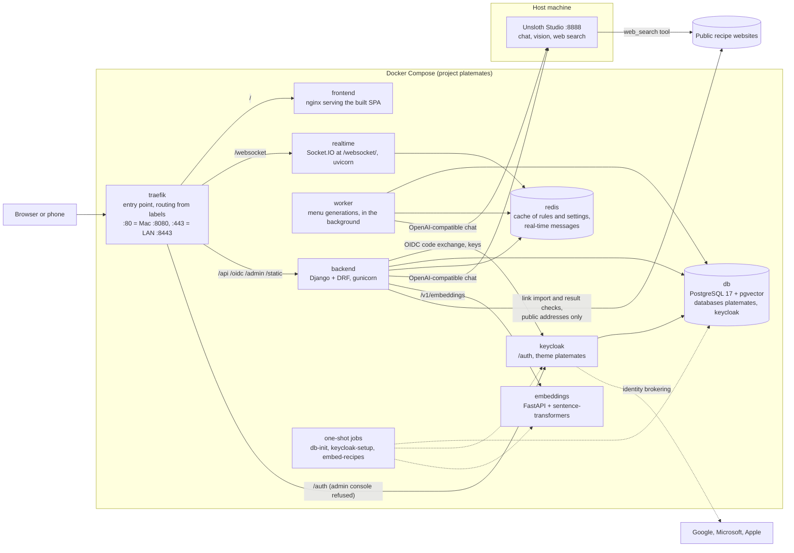
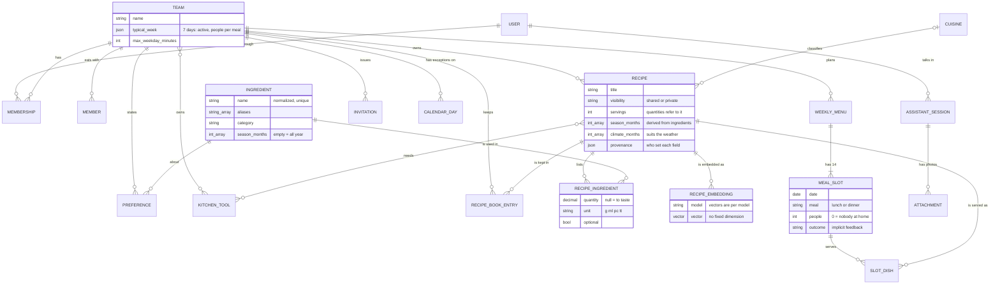
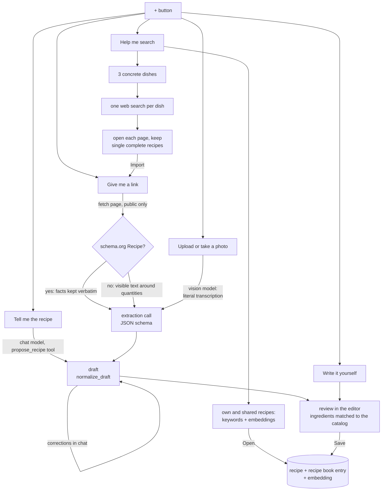

# Architecture

How the concepts in `README.md` map onto code. Read this before changing the data model or the AI
integration.

## Components

| Directory | What | Runs as |
|---|---|---|
| `backend/` | Django project `config`, domain apps in `apps/`, AI adapters in `ai/` | `backend` container, or `uv run` natively |
| `frontend/` | React + TypeScript SPA (Vite) | `frontend` container (nginx, static files only), or `npm run dev` |
| `services/embeddings/` | OpenAI-compatible `/v1/embeddings` around sentence-transformers | `embeddings` container, or `uv run uvicorn` |
| `keycloak/` | Keycloak image: login theme `platemates` + Apple provider extension, served under `/auth` | `keycloak` container; realm configured by `keycloak-setup` |

The frontend and backend always share one origin (Vite proxy in development, Traefik in the
stack), so the API uses Django session auth and CSRF without CORS. Both proxies must keep the
original `Host` header: Django builds the OIDC callback URL from it, Keycloak its own URLs.

**Traefik is the entry point** (decided 2026-10-07, replacing nginx as reverse proxy): routing
is declared as labels next to each service in `docker-compose.yml` (`/api /oidc /admin /static`
to the backend, `/auth` to Keycloak, the rest to the SPA; Traefik tries longer rules first), and
it follows containers as they are recreated, which nginx needed a DNS workaround for. Each route
has two routers, one per entry point (`web` plain HTTP, `websecure` TLS), because a Traefik
router either requires TLS or not. Keycloak's admin console is refused with an IP allow-list
nobody matches (Traefik has no deny middleware). The LAN certificate comes from the file
provider (`secrets/tls/tls.yml`, written by `scripts/setup_lan_https.py`) and is reloaded
without a restart; Let's Encrypt can be enabled the same way once the app has a public domain.
Traefik does not serve files, so the SPA stays in a small nginx container that only serves the
build. Traefik reads the Docker socket read-only to discover containers; on a machine exposed to
the internet, put a socket proxy in between (`docs/operations.md`).

**Authentication** is Keycloak (email/password, Google, Microsoft, Apple) with Django as OIDC
client, and access is invitation-only. Full design and setup: `docs/authentication.md`.

## Domain apps

| App | Models | Notes |
|---|---|---|
| `catalog` | `Ingredient`, `KitchenTool` | Global, shared by every team. Ingredient names are normalized on save (lowercase, single spaces); variants go in `aliases`. |
| `recipes` | `Cuisine`, `Recipe`, `RecipeIngredient`, `RecipeEmbedding` | Recipes live in one common pool; quantities refer to `Recipe.servings` and scale linearly. The method is `Recipe.steps`, one entry per step. |
| `teams` | `Team`, `Membership`, `Member`, `Preference`, `RecipeBookEntry`, `TeamEmbedding` | Everything team-specific. `RecipeBookEntry` is the per-team view of a recipe: candidate / approved / rejected, plus the explicit rating. |
| `menus` | `WeeklyMenu`, `MealSlot`, `SlotDish` | 7 days × {lunch, dinner}. Shopping list in `menus/shopping.py`, computed, never stored. |
| `accounts` | `OIDCIdentity`, `Invitation` | OIDC backend and login view (`oidc.py`), Keycloak realm setup (`keycloak_admin.py`), `/api/me/`, invitations. |
| `assistant` | `AssistantSession` | The recipe assistant: conversation turns (`agent.py`), the recipe draft shape shared by every mode (`draft.py`). |
| `core` | none (abstract mixins and helpers) | Seasonality and provenance helpers, shared serializer mixin. |

### Data model

Recipes and team preferences point to ingredients by id, never by name: renaming or merging an
ingredient never touches a recipe. An ingredient may appear on several lines of one recipe
(flour for the pastry and for the custard, each with its quantity and note): the shopping list
adds them up, and comparing a variant with its original works on each ingredient's total.

### Decisions worth knowing

- **The product is PlateMates** (2026-10-08; it was "WeeklyMenu" from 2026-10-07, and "Family
  Menu Planner" before). The technical identifiers follow it: Keycloak realm, theme and client
  (`platemates`, `platemates-backend`), the Compose project and its volume
  (`platemates_pgdata`), the database and its user, the backend image. The data was carried
  over with a dump and restore under the new names, and the Keycloak realm was renamed in
  place, so accounts and their `sub` survived. `menus.WeeklyMenu` is the domain model of a
  week's menu, not the product, and keeps its name.

- **Team, not family** (2026-10-07): the app serves whoever shares meals (a family, a person
  living alone, flatmates, friends, a sports team, an office). The model is `Team` (formerly
  `Family`) and the API speaks of teams (`/api/teams/`, `team` fields). The Django app lives in
  `apps/teams` but keeps its original label `families`, which keys the migration history and
  the table names (`families_team`, `families_member`, ...); the rename migrations kept every
  row.

- **Shared recipes, per-team recipe book** (confirmed by Paolo 2026-10-05). One `Recipe` row can be in many teams' books.
  A recipe has an **owner team** (the one that created it, the only one that can edit it;
  staff can edit everything) and a **visibility**: `shared` (default, decided 2026-10-06) or
  `private` (only the owner team sees it). `Recipe.objects.visible_to(user)` and
  `editable_by(user)` hold these rules. Creating a recipe through the API puts it in the
  creating team's book. Other teams add a shared recipe to their own book; the owner can
  delete a recipe only while no other team keeps it. Removing a private recipe from the
  owner's book deletes it.
- **Shared catalogs** (ingredients, cuisines, kitchen tools): any user may read and add
  entries, only staff may change or delete them (`CatalogPermission`), because an edit would
  silently change other teams' recipes. Ingredient search matches names and aliases.
  Ingredients and kitchen tools can be added from the recipe editor (no admin needed). The
  kitchen tools the app ships with carry a stable `code` and are shown translated
  (`tool.<code>` in the frontend locales); tools added by users have no code and are shown by
  the name they were given. Tool names are unique regardless of case.
- **Seeded ingredient catalog** (`catalog/migrations/0005_seed_common_ingredients.py`): about 160
  common ingredients in Italian (the first deployment's language) with category, unit, Italian
  seasonality and plural aliases. Idempotent and non-destructive: an entry is skipped when an
  ingredient already exists under its name or one of its aliases. Unlike shipped kitchen tools
  they have no code: ingredient names are data, matched by the assistant in the team's
  language. Database tests start from an empty catalog (`tests/conftest.py`); tests about the
  seed are marked `seeded`.
- **Preserved forms are distinct ingredients** with no season ("pomodoro pelato", "passata di
  pomodoro", "pisello surgelato", "tonno in scatola"): folding them into the fresh product would
  make a winter sauce of peeled tomatoes "in season" only in summer. The assistant's prompts say
  so, and `normalize_draft` forces an all-year season on names that denote a preserved product,
  because the model kept proposing the fresh product's season anyway.
- **Management section** (frontend `/manage`, staff only, from the user menu; also holds the
  system rules for menus): one page per shared catalog, starting with ingredients: search, category filter, sorting by usage, editing
  (name, aliases, category, unit, season), deleting unused ones, and merging duplicates
  (`catalog/services.py`: recipe lines and preferences move to the target, same-unit quantities
  are added up when a recipe had both, the duplicate's name becomes an alias). Changing an
  ingredient's season re-derives the season of the recipes using it (unless the user set it)
  and refreshes their embeddings.
  This is what makes collaborative recommendation possible ("teams like yours loved X"), and
  keeps discovery candidates separate from accepted recipes (`RecipeBookEntry.Status.CANDIDATE`).
- **People per slot.** The team calendar (typical week plus `CalendarDay` exceptions) says who
  eats at home; `MealSlot.people` is its copy in the week's menu, prefilled by
  `WeeklyMenu.create_empty_slots` and kept in step by `apps.teams.calendar.set_day`.
  `people = 0` means nobody eats at home, and that slot adds nothing to the shopping list.
- **Typical week** (decided with Paolo 2026-10-07). `Team.typical_week` is seven days, Monday
  first, each `{active, breakfast, lunch, dinner}`. A day turned off counts as 0 at every meal
  but keeps its numbers, so turning it back on restores them. It replaced the per-meal
  `default_people` (migration `families.0004` converted it: every day active, nobody at
  breakfast).
- **Calendar exceptions** (`CalendarDay`, `apps/teams/calendar.py`). A date that differs from
  the typical week (guests, someone away, a meal out) stores only the meals that differ, plus an
  optional note; a count equal to the typical week is not stored, and a row left with nothing is
  deleted. An exception can open a day that is usually off. `calendar(team, start, days)` is the
  single source of "who eats at home and what is planned" for the calendar screens and for new
  menus (`WeeklyMenu.create_empty_slots`).
- **One write path for a date** (`set_day`, `PUT /api/calendar/<date>/?team=`, owners only):
  people at some meals, the note, the dishes of some planned meals, each optional and the rest
  kept. Setting dishes creates the week's draft menu if there is none. Clearing a meal or a day
  is people 0 plus no dishes; Undo is the client sending back what it had. `DELETE` brings
  people and note back to the typical week and keeps the dishes. `GET /api/calendar/?team=&
  start=&days=` is open to every member.
- **Breakfast is counted, not planned** (decided with Paolo 2026-10-07). `Meal` includes
  breakfast so the calendar (and later the shopping list) knows who is at home, but the menu
  only gets slots for `PLANNED_MEALS` (lunch and dinner).
- **One or more dishes per slot** (confirmed by Paolo 2026-10-05). `SlotDish` allows e.g. a first course plus a side dish; most
  slots will have one.
- **Implicit feedback lives on the slot.** `MealSlot.outcome` (planned / followed / replaced /
  skipped), with `eaten_instead` when replaced. `rating` and `comment` are the optional explicit
  layer.
- **Seasonality: stored as months, edited by season or by month** (decided with Paolo
  2026-10-05). Storage is always an array of months 1-12; an empty array means "all year". Users
  edit in two modes: **by season** (default; meteorological seasons, e.g. summer = June-August)
  or **by month** (advanced). The API field (`SeasonalityField`) reads as
  `{"months": [...], "seasons": [...], "by_season": bool}`, where `by_season` says whether the
  value is a union of whole seasons and so can be shown in season mode. It accepts
  `{"seasons": [...]}` or `{"months": [...]}` on write, or `{"auto": true}` to hand the value back
  to automatic derivation. A recipe has two levels:
  `season_months` (derived bottom-up via `Recipe.derive_season_months`, the intersection of its
  non-optional ingredients' months, or their union when they do not overlap; recomputed on every
  save until the user sets it) and `climate_months` (whether the dish suits the weather).
  `Recipe.suitable_months()` combines them.
- **Proteins are explicit categories.** `IngredientCategory` separates red meat, white meat, cured
  meat, fish, seafood, egg, legume and cheese, so the "no same protein on adjacent days" rule can
  be checked from data.
- **Kitchen tools that heat the kitchen** (`KitchenTool.heats_kitchen`) are what "avoid the oven in
  summer" is computed from.

### Languages

The interface is multilingual: **Italian by default**, English available (decided 2026-10-05).

- Frontend: i18next (`frontend/src/i18n/`), one JSON file per language under `locales/`. The
  language comes from the user's last choice, then the browser, then Italian. Every visible string
  goes through `t()`; enum values from the API (categories, seasons, outcomes) are translated in
  the frontend from their stable codes.
- Backend: `LANGUAGES = it, en`, `LocaleMiddleware`, and choice labels wrapped in `gettext_lazy`.
  The SPA sends `Accept-Language`, so DRF error messages follow the interface language. Admin
  translation files (`backend/locale/`) need GNU gettext (`brew install gettext`) to generate
  with `makemessages -l it` and are not created yet.
- Code, identifiers and stored codes stay in English. Recipe content (titles, instructions) is
  data and stays in whatever language it was written in.

### Provenance: the user has the final say

Models carrying LLM-suggested or derived properties inherit `ProvenanceMixin`
(`apps/core/provenance.py`): a JSON map `field -> "llm" | "derived" | "user"`.

- Automatic code sets values only through `obj.propose(field, value, Source.LLM | Source.DERIVED)`,
  which refuses to overwrite a field whose source is `user`.
- Every write through the REST API is a user decision: `UserDecisionSerializerMixin` marks the
  fields listed in a serializer's `Meta.tracked_fields` as `user`.

Never assign a tracked field directly from LLM output; always go through `propose`.

### Team management (built 2026-10-07)

The team page (`/team`, from the user menu or the team name in the top bar) covers the profile
(name, weekday time limit, kitchen tools), the people at the table
(`Member`: name and birth year, no account needed), users and roles (`Membership`), and
invitations. The typical week has its own page (`/week`, from the menu screen), with the
team's rules for planning menus.

- **Owners manage, members read** (`OwnerWritesMixin`, `require_owner` in
  `apps/teams/permissions.py`): profile, people, roles and invitations are changed by owners;
  every member sees them and can leave. Invitation tokens are only ever sent to owners: the token
  *is* the invitation. Before this, any member could change the team and read every link.
- **A team always keeps an owner**: the last owner can neither step down nor leave
  (`MembershipViewSet`); someone else must be made owner first.
- **Teams are not deleted from the app**: it would take every member's recipe book and menus
  with it. New teams are still created by staff (`create_team`), access being invitation-only.
- **Invitations**: a single-use link valid 14 days, copied or shared through the phone's share
  sheet (Web Share API), listed with who created it and who accepted it. No email yet (needs SMTP).
- Tastes (`Preference`) have no screen yet: they come with the menu engine that uses them.

### Navigation (decided with Paolo 2026-10-07)

Material 3 adaptive navigation (`components/Navigation.tsx`): a navigation rail on tablets and
desktops, a bottom navigation bar on phones, for the everyday destinations: **Menu** (the weekly menu and calendar, home,
`/`) and **Recipes** (`/recipes`); the shopping list joins them once it has a screen. The team
page, the management section, the language and the theme stay in the user menu: they are visited
rarely. The theme is light, dark or automatic (following the device), saved per user like the
language (`UserProfile.theme`) and applied with MUI's `useColorScheme`; the Keycloak login
pages still follow the device. Administrators have a small Yoda badge on their avatar.
The calendar is also the menu screen ("Menu della settimana"): one week at a time
(`?week=<monday>`), moved by arrows; "Today" appears beside the arrow that leads back to the
current week (its slot is reserved, so nothing shifts), and the week's dates open a month
calendar (MUI X `DateCalendar`) to jump to any date. A row per day
with a card per meal (people, dishes; exceptions in terracotta, nobody at home dimmed). The day's
gear (or its date) opens the day settings, the bin clears the day or a single meal at once with
Undo. With a mouse or trackpad these icons appear only on hovering the day's heading or the
card (or on keyboard focus); on touch screens they are always shown. The choice follows the
pointer (`(hover: hover) and (pointer: fine)`, `src/hover.ts`), not a guess about the device. A card's magnifier (and
each dish's on the meal page) opens the recipe dialog: quantities for the meal's people,
ingredients and steps, one tab per recipe when the meal has several; dishes without a recipe
have none. The dialog and the recipe page share `components/RecipeView.tsx`. A meal card opens the meal page (`/calendar/<date>/<meal>`): people, and the dishes picked
from the recipe book until the menu generator proposes them. Members see everything read-only.
The screen's FAB (`components/MenuFab.tsx`, on the same `ActionFab` as the recipe book's) holds
the generation actions and the way to the typical week: see "Generating a menu" below.

### Multi-team access

A user sees only teams they hold a `Membership` in, and gets one only by accepting an
invitation (or by staff creating the team for them). Viewsets over team-owned data use
`TeamScopedMixin` (`apps/teams/permissions.py`), which filters querysets and rejects writes
pointing at somebody else's team. Global catalogs (ingredients, tools, cuisines, recipes) are
readable and writable by any authenticated user for now.

## Generating a menu: triggers and rules (decided with Paolo 2026-10-08)

A menu is generated on request only, from the menu screen's FAB: there is no scheduled
generation yet (it would need a job scheduler). The FAB has three entries:

1. **Generate this week's menu** (main entry): starts at once with the standing rules.
2. **Tell me how to plan it**: a dialog with the team's rules, each with its own checkbox plus
   a global one that switches them all off, and a free text for this week only. The week's
   settings are saved on its `WeeklyMenu`, so whoever regenerates finds them again.
3. **Set up the typical week**: the `/week` page, with the meal pattern (people per meal, moved
   there from the team page) and the team's rules.

**Rules** are natural-language sentences that guide the LLM, on three levels, the later
overriding the earlier where they conflict (the prompt states the precedence, and the LLM
says in its rationale how it resolved a conflict):

| Level | Written by | Stored in | Editable |
|---|---|---|---|
| System | us, then staff live | `menus.SystemRule`, Italian and English text | by staff, from `/manage/rules`; teams read-only |
| Team | owners | `menus.TeamRule`, one row per sentence | yes, from `/week` |
| Week | any member | `WeeklyMenu.instructions`, `use_team_rules`, `excluded_rules` | yes, from the dialog |

- **System rules live in the database**, so they can change on a live install without a
  release. The shipped ones are seeded by a data migration (`0007_seed_system_rules`) with a
  stable `code`: idempotent and never destructive, it creates only codes not yet present and
  never overwrites a live edit; a change to a shipped rule goes in a new data migration. Shipped
  rules are switched off, not deleted; rules added by staff have no code and can be deleted.
  Each rule carries both interface languages (`text_it`, `text_en`), as the text is edited
  live and cannot sit in the frontend's locale files. Among them: compose each meal roughly
  like Harvard's Healthy Eating Plate (half vegetables, a quarter grains, a quarter protein).
- Team rules are a list of short sentences, not one text, so a week can leave out a single
  one. `use_team_rules = False` leaves them all out, including rules added later.
- Hard constraints are enforced by code, not trusted to the text: meals with nobody at home are
  not planned, "never propose" preferences are excluded, dishes already set stay.
- `Team.notes` is a note for the team's users: it is **not** passed to the LLM.
- **The starting point can be a partly planned week.** The user may set dishes on some meals and
  the people on any meal before generating: those are fixed, and the generator fills only the
  open meals. Proposals stay distinct from user decisions until accepted; regenerating replaces
  only proposals that were not accepted.
- **The week's text can change the people too** ("thursday dinner we are five"). People live in
  the calendar (`CalendarDay`), written only by `set_day`: the generator does not write there,
  it returns the change as a proposal, planned against the proposed count and applied to the
  calendar when the user accepts it.
- Generation runs in the background as a record holding its status, a snapshot of the rules
  used, the result and the rationale: the user can leave the page, and the history later serves
  as context for feedback.

### The generator (built 2026-10-08)

- **A queue in the database, a worker beside the backend.** `POST /api/menus/generate/` creates
  the week's menu if needed and queues a `MenuGeneration` (one active per week, enforced by a
  partial unique constraint; a second request gets the running one with 409). The `worker`
  compose service runs `manage.py worker` (it also drafts system recipes, after any
  generation waiting), which claims queued generations with
  `SELECT ... FOR UPDATE SKIP LOCKED`, one at a time, and on start marks as failed any left
  running by a worker that stopped. No Celery: the LLM serves one request at a time anyway,
  and a Raspberry Pi has no room to spare.
- **Woken by PostgreSQL, not by polling** (decided with Paolo 2026-10-08). The API sends
  `pg_notify('menu_generations')` in the transaction that queues the generation, so it leaves
  only at commit; the worker waits in `LISTEN` on its connection and starts at once (measured:
  under 0.1 s), asking the database nothing while idle. A notification is not stored anywhere:
  one sent while the worker is down or reconnecting is lost, so the worker also looks at the
  queue on start and every 60 s (measured: a generation queued without notification was taken
  after 51 s). It reconnects and listens again if the database goes away. The queue stays in
  PostgreSQL rather than Redis, which is a cache without persistence.
- **Progress reaches the browser in real time** (see "Real-time messages" below). The model's
  answer is streamed (`chat_stream`): the worker announces each phase (queued, preparing,
  thinking, planning, writing with meals done out of the open ones, checking, retrying, done
  or failed). A generation has a time limit, both attempts included (setting
  `menu.max_seconds`, 6 minutes); the HTTP client's timeout (`LLM_TIMEOUT_SECONDS`) now only
  bounds a silence of the model. Stopping the worker interrupts the streamed call at once and
  marks the generation failed ("Interrupted"), instead of waiting for the model.
- **Retrieval first, then one LLM call** (`apps/menus/generation.py`). The code picks the
  candidates: the team's recipe book and own recipes (at most 40), plus a few in-season shared
  recipes to discover, without "never propose" ingredients or cuisines, rejected recipes, or
  recipes needing tools the team lacks; sorted by season, rating and how long since last eaten.
  The prompt has the three levels of rules, the team (ages, weekday time limit, tastes), one
  line per meal (OPEN, FIXED with its dishes, or nobody at home), what was eaten in the last
  two weeks, and one line per candidate (`R1 ...`). It fits the model's 8k-token context with
  room for the answer (about 3.8k characters for a week). Vector similarity joins retrieval
  when recipe books grow.
- **Structured answer, validated in code.** JSON schema with `rule_plan` first: one line per
  team rule and week instruction with the meals it applies to, written before the meals.
  Without it the model noticed broken rules only in its rationale, after the plan (2026-10-08:
  "pizza on Friday evening" landed on Thursday; with it, 3 runs out of 3 were right). Day and
  meal names are in the rules' language ("venerdì cena"), so rules match meals. Validation
  keeps only what may be proposed: meals of this week that are open, recipes from the
  candidates, at most 3 dishes per meal, people from 0 to 50; ids in free text become titles.
  An unusable answer is retried once. The model's own reasoning is the `menu.thinking` setting:
  with an 8k context it used up the tokens before answering (84 s, no answer); at 64k it works,
  takes 2-2.5 min instead of 25-40 s, and reasons better about the rules (it put the recipes
  longer than the 20-minute lunch limit at dinner, and said so).
- **New dishes.** With a small recipe book a week cannot be planned from it alone, so a dish
  may be a title without a recipe (`SlotDish.title`, `recipe` null), proposed as "new". The
  user can also write such a dish in. Dishes without a recipe add nothing to the shopping list.
- **Proposals and review** (`apps/menus/review.py`). Proposed dishes are `SlotDish.proposed`,
  proposed people `MealSlot.proposed_people` with a reason; the calendar returns both. Accept
  makes the dishes the user's and applies the people through `set_day`; reject deletes the
  proposed dishes and the people change; per meal (card buttons, meal page) or the whole week
  (`POST /api/menus/<id>/review/`). Every member can generate and review. Proposals stay off
  the shopping list until accepted. Editing a meal keeps the proposals left in it; setting a
  meal's people settles the proposed change.
- Measured on Qwen3.6-35B-A3B (Studio, M-series Mac): 25-40 s for a week of 14 meals.

## Community and system recipes (decided with Paolo 2026-10-08)

Recipes become a community: the system's own, curated, plus those teams choose to share.

- **System recipes** belong to a system team, "PlateMates", edited by staff only; they are
  always in the community.
- **Sharing is a choice made at every save**: no default visibility, the editor asks. Recipes
  shared under the old default (shared) stay shared; their team can make them private.
- **Signature**: each team chooses in its profile whether its shared recipes show its name or
  are anonymous ("from the community").
- **Two ways to use a community recipe**: add it as it is (a reference, as today: it follows
  the author's changes and is not editable), or import it and change it: a copy owned by the
  team, linked to the original (`derived_from`), independent from then on.
- **Variants**: a shared copy is listed as a variant of the original recipe, always of the
  original (a copy of a copy is a variant of the first one), in one flat list. A copy that is
  not shared is invisible to others.
- **Recipe book screen**: two switches, "my recipe book" and "community", on together or
  apart; each recipe shows where it comes from (mine, system, another team, variant of...).
- **System recipes from LLM drafts with sources, reviewed by staff**: staff asks for a dish or
  a batch ("10 autumn first courses"); the worker searches the web, keeps only pages that
  really hold a recipe (schema.org Recipe, as the assistant's search does), has the model draft
  the recipe from those sources (or without, if none), through `normalize_draft`, and queues
  it in the management section for staff to edit and publish or discard. Each draft carries
  two separate ratings, neither estimated by the model: **reliability** (how many real sources
  were found and whether they agree; low when the model drafted it with none) and **web
  rating** (the `aggregateRating` average and count read from the source pages; none for an
  invented recipe). Staff sees both while reviewing; users see only the web rating.
- **Order**: first the community (system team, choice at save, signature, import and change,
  variants, recipe book switches), then system drafts with sources and the review queue, then
  the menu generator using community recipes, so that hard constraints and the shopping list
  hold for proposed dishes too, and invented dishes become the exception.

Built so far, the community (2026-10-09):

- `Team.is_system` (one at most, partial unique constraint; created by the data migration
  `families.0008_system_team`, idempotent) and `Team.sign_shared_recipes` (default anonymous,
  from the team profile). The system team has no members, so it is never one of a user's
  teams; staff write its recipes (`/api/me` gives them its id, the editor offers "system
  recipe"), always shared.
- `RecipeSerializer.visibility` has no default: creating a recipe without it is refused, and
  the editor's choice starts empty (an assistant draft and an import included).
- `Recipe.derived_from` (`SET_NULL`, never itself): set once, on create, by "import and
  change" (`/recipes/new?from=<id>` opens the editor filled from the original; nothing is
  saved until the user saves). A copy of a copy is stored as a variant of the original. The
  team's version replaces the original in its book if it had added it as it is (the original
  recipe is untouched), so the book never shows two cards for one dish; the original's page then
  points to the team's version (`my_version`) instead of offering a second import.
- `author` (system, mine, a signing team, or anonymous community) and `origin` (the original,
  if the user can see it) on every recipe; `GET /api/recipes/<id>/variants/` gives the
  original of a variant and the other variants the user can see.
- `GET /api/recipes/browse/?team=&mine=&community=` serves the recipe book screen: the team's
  book, the community (shared recipes of the system and of other teams), or both, with each
  recipe's author, origin and whether it is in the book. The switches are remembered per
  browser.

System drafts with sources (2026-10-09), `apps/curation`:

- `SystemDraft`, one per dish, queued by staff from Management > System drafts (dishes by name,
  or a theme and a count, for which the model suggests names leaving out existing system
  recipes) and run by the worker (`manage.py worker`, the former `menu_worker`: menu
  generations first, then drafts), woken by `NOTIFY system_drafts`. Phases reach staff live in
  the realtime service's `staff` room.
- Sources: one web search per dish (Studio's own), every URL opened and kept only if it holds
  exactly one complete schema.org Recipe, at most two, from different sites. Pages already
  imported by a team are not excluded here, unlike the assistant's search.
- The draft: one source is extracted faithfully (as a link import, structured facts winning);
  two are combined by the model, keeping what they agree on; none, and the model writes the
  usual version from what it knows (if it does not know the dish it says so and the draft
  fails, rather than inventing one). Always through `normalize_draft`.
- Ratings, computed by code: reliability high (two sources whose ingredient words overlap at
  least 35%, Jaccard), medium (one source, or two that differ), low (none); web rating, the
  sources' `aggregateRating` brought to five stars and averaged by votes. Measured: ribollita
  high, 4.3 from 309 votes; pasta alla Norma medium (two different versions), 4.1 from 465;
  20-30 s a dish.
- Review and publish: "Review and publish" opens the recipe editor with the draft, as an
  assistant draft (unknown ingredients to create or pick), "system recipe" on; saving it with
  `system_draft` creates the system recipe, copies the web rating (`Recipe.web_rating`, read
  only, shown to everyone) and marks the draft published. Drafts can be discarded and retried.

## Application settings (decided with Paolo 2026-10-08)

Settings that tune how the app behaves live in the database (`apps/siteconfig`), so an
administrator changes them live, without a release or a restart; `.env` keeps what belongs to
the deployment (addresses, secrets, who the administrators are).

- What can be set is defined in code (`siteconfig/registry.py`: key, type, default, limits);
  `ConfigVar` stores only values that differ from the default, with who changed them and when.
  `registry.get` falls back to the default when a stored value no longer fits its definition.
- Administrators are users with Keycloak's realm role `admin` (see `docs/authentication.md`);
  the page is Management > Settings (`/manage/settings`), the API `/api/config/`, both
  refused to anyone else. The management section shows each user only the sections of their
  roles: staff the catalogs and system rules, administrators the settings.
- Settings so far: `llm.context_tokens`, the context the chat model is loaded with, from which
  the assistant's history and photo text budgets and the menu's candidate count follow (9000
  characters and 40 recipes at 8k, the size they were tuned at); `menu.thinking`, the model's
  own reasoning when planning a week (used only with a context of at least 32k, where it has
  room to answer; each generation records whether it used it).

### Real-time messages (decided with Paolo 2026-10-08)

The browsers hear about changes through **Socket.IO** (python-socketio, socket.io-client),
chosen over Django Channels for Paolo's experience with it and its client's built-in
reconnection. It runs as its own service, `realtime` (`apps/realtime`, uvicorn, ASGI), routed
by Traefik at `/websocket/`, so long-lived connections never hold the backend's gunicorn
threads.

- **Login is the session cookie**: on connect the server loads the Django session as the
  session middleware would (hash check included) and refuses anyone not signed in; no token
  is ever sent to the browser. Origins are the app's own (`DJANGO_CSRF_TRUSTED_ORIGINS`).
- **One room per team** (`team-<id>`), joined on connect for every team of the user; the SPA
  reconnects when the user's teams change. Browsers only listen.
- **Any process sends** through Redis (`apps.realtime.events.publish`, `RedisManager` in write
  mode): the backend (a generation queued) and the worker (its phases). Messages use their own
  Redis database (`REALTIME_REDIS_URL`, `/1`), so clearing the cache never touches them.
  Sending never fails the caller.
- **Events are notices, not data**: one missed while disconnected is lost, so a screen reloads
  its state from the API whenever the connection is (re)established (`useOnConnect`). While it
  is down, the menu screen falls back to reading a running generation every 15 s.
- Events so far: `generation`. Planned: `calendar.changed`, so that members see the week change
  as someone else edits it.

### Cache (decided with Paolo 2026-10-08)

Rules and settings are read at every use, never loaded at start-up, so a change never needs a
restart. They go through a two-level cache (`apps/core/cache.py`, `CacheManager`): this
process's memory first (Django cache `local`, `CACHE_MEMORY_TIMEOUT_SECONDS`, 10 s), then Redis
(`default`, shared by the backend's processes and the worker, `CACHE_REDIS_TIMEOUT_SECONDS`,
12 h), then the database; a value found in Redis is copied back to memory. Cached so far: the
stored settings (`siteconfig:values`), the active system rules, each team's rules.

- **Every change clears it**: `post_save` / `post_delete` of `SystemRule`, `TeamRule` and
  `ConfigVar` empty Redis and this process's memory; other processes see the change within
  their 10 s. Signals do not fire on bulk `update()`: those models are written with `save()`.
  The backend also clears it after its migrations at every start, so seeded data and changes
  made while it was down are never hidden.
- **Redis is only a cache**: no persistence, 128 MB with LRU eviction. If it is unreachable the
  app reads from the database and keeps values in memory only.
- Management > Cache (administrators): Redis's figures (keys, memory, hits and misses,
  uptime), the counters of the backend process that answered, the last clear and by whom, and
  a button to clear it (for data changed some other way, such as the Django admin).

## Adding recipes (decided with Paolo 2026-10-06)

Built so far: MUI theme, recipe book (search, course filter, "in season" badge, ratings),
recipe page (scaling by number of people, rating, add/remove from book), the recipe editor, the
"+" FAB menu and the assistant in all four modes: "tell me", "help me search", "give me a link"
and "photo". A mode is enabled (`AVAILABLE_MODES` in `apps/assistant/models.py`) only once its
tools exist: offering a
mode before its tools exist would let the LLM invent the content of pages or photos.

**How the assistant works**

- An `AssistantSession` (team, user, mode) stores the exchange in OpenAI chat format, so a
  draft survives a page reload; only its author sees it.
- Each turn (`apps/assistant/agent.py`) sends a mode-specific system prompt plus the history and
  one tool, `propose_recipe`, whose parameters are the draft schema (`draft.py`). The model
  either asks a short question or calls the tool with the **whole** draft; after each correction
  it calls it again, so the latest call is the current draft. Tool calls and their results stay
  paired in the history. The history is trimmed at user turns to fit the 8k context; when it
  is, the current draft is re-sent as a system note.
- Drafts are normalized (`normalize_draft`): units mapped (kg -> g, "q.b." -> to taste),
  unknown categories/courses fall back to safe values. Measured live 2026-10-06 with
  Qwen3.6-35B-A3B: first draft in 7-16 s, a correction in about 4 s.
- Draft ingredients are matched to the catalog (`apps/catalog/matching.py`): exact name or
  alias, otherwise PostgreSQL trigram similarity (`pg_trgm`), preselecting a candidate from
  0.45 similarity ("pomodori" -> "pomodoro") and flagging it for the user to check.
- "Review and save" opens the editor with `?session=<id>`: matched ingredients are filled in,
  unknown ones must be created (category, unit and season prefilled from the draft) or replaced
  before saving. Saving links the recipe to the session and closes it.
- Gunicorn runs threaded workers so a turn waiting on the LLM does not block other requests.

**Link import** (`apps/assistant/web.py`, built 2026-10-06)

- A message containing a URL, in "tell me" or "link" mode, imports the page instead of asking
  the chat model. One page, the one given, fetched once; no crawling.
- **Only public addresses are fetched**: every redirect hop is checked, and every address the
  host resolves to must be global. `keycloak:8080`, `db`, `host.docker.internal`, LAN and
  loopback addresses are refused (verified from inside the backend container). The page is
  capped at 3 MB and must be HTML. A DNS answer changing between check and connection is not
  covered; acceptable for a team app, revisit before exposing the app widely.
- Text for the model: schema.org `Recipe` data when present, else the visible text with block
  elements split into lines (minified pages are one line otherwise) and cut to a ~9k-character
  window around where quantities cluster.
- A separate extraction call (`response_format` with the draft schema, temperature 0) structures
  the text. Ingredient names are always in the user's language, generic and singular, so they
  match the team catalog (an English page still yields "uovo", "parmigiano"); title,
  description and steps stay in the page's language. Cups, ounces and spoons become g/ml with
  the original measure in the note.
- From structured data, title (site name stripped), servings, times and steps are kept
  verbatim rather than as the model rewrote them; GialloZafferano-style photo numbers in steps
  ("padella antiaderente 4 e") are removed when they form a 1, 2, 3, ... sequence.
- The result is recorded in the history as a `propose_recipe` call, so corrections ("for 2
  people") work as in "tell me"; the source URL survives corrections.
- Failures carry a stable code (`unreachable`, `http_error`, `no_content`, `no_recipe`, ...)
  that the UI translates; the code is stripped from what is sent back to the model.
- Measured live: 9-16 s per import on GialloZafferano, Il Cucchiaio, BBC Good Food, Acadèmia and
  a small blog.

**Photo import** (built 2026-10-06)

- The camera button next to the message box works in every mode (in "photo" mode it is the
  main action); on phones it opens the back camera. The browser downscales to 1280 px JPEG before
  upload (`frontend/src/images.ts`): a 3300x4200 photo became 73 KB, about 1,500 tokens for the
  vision model. The backend accepts only JPEG/PNG/WebP, checked by their bytes, up to 10 MB
  (Traefik sets no body limit).
- Photos are stored in the database (`Attachment`), so they are in the backups, are shown beside
  the draft in the review screen, and are visible only to the conversation's author.
- Two steps, as decided: a strictly literal transcription by the vision model (`LLM_VISION_MODEL`,
  default the chat model), then the same structuring as link import. Compared on synthetic
  cookbook pages and handwritten cards (2026-10-06): with the literal prompt Qwen3.6 transcribed
  faithfully (one inflection wrong), gemma-4-E2B misread words, invented one and reordered a
  paragraph. The review screen shows each photo with the text read from it.
- All photos of a conversation are read together, so a recipe spanning pages is sent as several
  photos. Untested on real photos (blur, real handwriting).
- Measured live: 10-25 s per photo.

**Help me search** (`apps/assistant/search.py`, built 2026-10-06)

- Each message in search mode is a search; earlier messages of the conversation are added as
  context, so "with potatoes" refines the previous request. Picking a web result sends its URL:
  the conversation becomes a link import (mode switches to `link`), and later messages correct
  the draft.
- **Local**: keyword matches first (every meaningful word, roughly stemmed, must appear in the
  title or an ingredient: matching any word turned "un dolce al cioccolato" into a leek soup via
  its "paprika dolce"), then embedding similarity from 0.4. Shown as "in your recipe book" or
  "from other teams" (shared recipes only; private ones never leave their team).
- **Web**: the chat model first turns the request into 3 concrete dishes (about 1 s; vague
  requests otherwise find only category and collection pages), then runs one web search per
  dish through Unsloth Studio's built-in search, two at a time. A result is shown only if its
  page exists, is public, and declares exactly one schema.org Recipe with ingredients and method;
  its title is the page's own. Measured: 22-29 s, 4-6 results.
- What was learned on the way (2026-10-06): asked for JSON, the model invented every URL without
  searching; left free, it chained searches for 90-110 s and nearly filled the context; Studio's
  search tool fails intermittently (the model then answers without links: retried once) and can
  hang up to its 300 s default (capped at 15 s per call).
- **Studio's server-side tools are restricted to `web_search`** (`ai/studio.py`, `SAFE_TOOLS`):
  for local models Studio also offers `python`, `terminal` and `edit_file`, which run on the
  host, and search prompts carry user text. Tool calls per message are capped too.

- **UI library**: MUI (Material UI) with the app's own theme (colours as in `frontend/src/index.css`).
  Material 3's guidance is followed where MUI allows (e.g. labelled FAB menu items).
- **Entry point**: a "+" FAB on the recipe book. **Tap/click always opens the menu** (hover may
  open it early on desktop), with labels always visible, so it behaves the same on touch:
  1. "Tell me the recipe" (first, highlighted): the user describes it, the LLM builds
     ingredients and steps, asking questions only when something essential is missing;
  2. "Help me search": guided search, local recipes first, then the web (Studio's built-in
     search);
  3. "Give me a link": import from a recipe page;
  4. "Upload or take a photo": a cookbook page, a handwritten card, a screenshot.
- **One assistant, three entry points**: the menu items open the same conversational panel in a
  given mode; the LLM still recognizes a pasted link or a search request in any mode.
- **Every path ends in the same draft review** (which doubles as manual entry): everything the
  LLM proposed is editable and marked as suggested (provenance) until the user saves.
  Ingredients are matched to the catalog, or proposed as new with suggested category/season/unit.
- **Visibility**: recipes are **shared by default** with other teams (the collaborative
  recommendation needs a common pool); a team can mark a recipe private.

**Link import** (no crawling, no per-site scrapers; it reads only the page the user gave):

1. schema.org `Recipe` JSON-LD in the page, parsed without any LLM. Checked 2026-10-06: present on
   GialloZafferano, La Cucina Italiana, BBC Good Food, Acadèmia; absent on Il Cucchiaio and on a
   small blog.
2. Otherwise, LLM extraction from the page's visible text into the recipe JSON schema
   (`response_format`). Generic "main content" extractors are not enough: trafilatura dropped Il
   Cucchiaio's ingredient box, losing every quantity. What worked: all visible text, cut to a
   window around where quantities ("320 g", "50 ml") cluster, ~9k characters to fit the context.
   Both pages extracted correctly in 3-6 s.
3. Pages that cannot be read this way (rendered by JavaScript, bot-protected, social/video posts)
   fall back to asking the user to paste the text or take a screenshot (photo mode).

**Photo mode**: a vision-capable model reads the image. Checked 2026-10-06 with a synthetic
handwritten card: both `Qwen3.6-35B-A3B` and `gemma-4-E2B` read it in ~5 s, but Qwen, asked to
"transcribe", **embellished the method with steps not on the card**. So photo import is two
steps: a strictly literal transcription prompt ("only what is written, nothing added"), then the
same structuring as link import, and the review screen shows the source image beside the draft.
Real photos (blur, real handwriting, two-column cookbook pages) are untested.

**Context size**: Studio currently loads the chat model with an 8,192-token context (the model
supports 262k). Page text, images and conversations all count against it; raise it in Studio
when loading the model if long pages or conversations get truncated.

**Build order**: 1. MUI, recipe book, draft review / manual entry; 2. FAB and assistant panel;
3. link import; 4. photo import (reuses link import's structuring); 5. "Tell me the recipe";
6. "Help me search" (needs recipe embeddings first).

Application code depends only on the protocols in `ai/base.py` and on `get_chat_provider()` and
`get_embedding_provider()`. The concrete provider is chosen by environment variables
(`LLM_*`, `EMBEDDINGS_*`, see `.env.example`) through the registries in `ai/factory.py`.

| Provider key | Class | Use |
|---|---|---|
| `openai_compatible` (chat) | `OpenAICompatibleChat` | Any OpenAI-compatible server: llama.cpp, vLLM, Ollama, cloud |
| `unsloth_studio` (chat) | `StudioChat` | Same, plus Studio's `enable_thinking`/`enable_tools` flags and model-loaded checks |
| `openai_compatible` (embeddings) | `OpenAICompatibleEmbeddings` | `services/embeddings`, Studio's `/v1/embeddings`, cloud APIs |

To add a provider: implement the protocol, register it in `ai/factory.py`. Nothing else changes.

### Unsloth Studio

Behaviour verified in the sibling project `../spyone` (Studio 2026.9.2) and carried over:

- Base URL `http://127.0.0.1:8888`; bearer API key from Settings → API keys (`LLM_API_KEY`).
- `{"detail": "Not authenticated"}` means a missing or expired key; 503 means no model loaded.
- Studio serves only the currently loaded chat model, unless **Settings → API → "Switch model by
  request"** is on. `StudioChat.ensure_model_available()` checks this upfront and gives a clear
  error instead of Studio's bare 404.
- Default chat model: `unsloth/Qwen3.6-35B-A3B-MTP-GGUF` (MoE, 3B active), the same one spyone
  uses. `unsloth/gemma-4-E2B-it-GGUF` is the light alternative for fast iteration.
- From inside Docker, Studio is reached at `host.docker.internal:8888` (set in `docker-compose.yml`).

Verified live on 2026-10-05 against this project's adapter:

- **Function calling works**: passing OpenAI-style `tools` returns `finish_reason: "tool_calls"`
  with well-formed `tool_calls` (JSON arguments). This is what the agentic menu engine builds on.
- **`enable_tools: true` turns on Studio's own server-side web search**: the model searched,
  and the source URLs it cited resolved (HTTP 200), not hallucinated. This is the "native web
  search" recipe discovery relies on. Search results inflate the prompt (~1.9k tokens for one
  query). Keep it off for menu generation and on only for discovery.
- "Switch model by request" is on in Paolo's Studio, so a non-resident model is loaded on demand.

### Embeddings

- Default: `sentence-transformers/paraphrase-multilingual-MiniLM-L12-v2` (384 dimensions,
  multilingual, light enough for a Raspberry Pi), served by `services/embeddings`. Vectors are
  L2-normalized, so cosine similarity equals the inner product.
- Embedding tables (`RecipeEmbedding`, `TeamEmbedding`) store the **model name** with each
  vector, and the vector column has **no fixed dimension**. Swapping model means recomputing the
  rows for the new model, with no migration. The trade-off is that pgvector cannot build an ANN
  index on an undimensioned column. At recipe-book scale exact search is fast enough; add a
  dimensioned, indexed column if that ever stops being true.
- `content_hash` records which text was embedded, so stale vectors can be found after edits.
- Recipes are embedded (`apps/recipes/embeddings.py`) from a short document: title, course,
  cuisine, ingredient names, description, the start of the method. On every save, after the
  transaction and best effort (a down embedding service never blocks a save); the one-shot
  `embed-recipes` compose service (`manage.py embed_recipes`, idempotent) catches up on every
  `up`. The embedding service is part of the default stack, with a readiness check that passes
  once the model is loaded.

## Future: translated ingredient names (recorded 2026-10-07)

Ingredient names are stored in a single language (Italian, the first deployment's). A team
using the app in English would see Italian names, and its assistant would create English
duplicates ("tomato" next to "pomodoro").

What makes it tractable: recipes, team preferences and embeddings reference an ingredient by
its id (`RecipeIngredient.ingredient`, `Preference.ingredient` are foreign keys), never by name.
The name is a display and matching attribute only, so translations can be added without touching
any recipe. A possible shape:

- per-language names and aliases on the ingredient (e.g. `names: {"it": "pomodoro", "en":
  "tomato"}`, `aliases: {"it": [...], "en": [...]}`), the current `name` becoming the canonical
  key; the UI shows the name in the interface language, falling back to the canonical one;
- matching (`catalog/matching.py`) and search look at the names and aliases of every language,
  so an English recipe matches the existing "pomodoro";
- the assistant keeps writing ingredient names in the user's language, and a new ingredient gets
  its other-language names proposed by the LLM, to be confirmed in the management section like
  any other suggestion (provenance);
- the seeded catalog gains English names in a data migration.

## Not built yet

Vector similarity in menu retrieval, recipe discovery, embedding computation jobs,
collaborative recommendation, a UI for creating invitations, streaming replies, weekly menus
and the shopping list UI.
